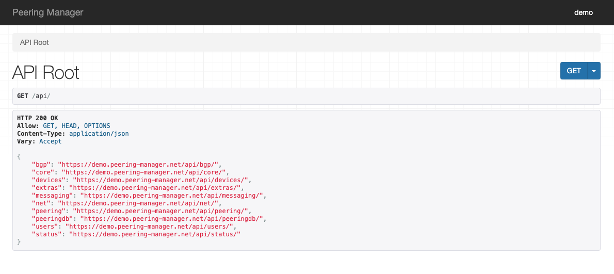

import ReferenceLink from "../../src/components/Card";

## Use this adapter

In a [configuration package](../configuration-package.mdx), name `peeringmanager` as the source. Then register the package, create and review a plan, and apply the plan, as described in [Run a sync](../running-a-sync.mdx).

The worker gets the values of the stored credential that the block names from the Sync API for each run. For a registered package, it reads no token, username or password from its environment, and address variables do not replace the declared URLs. The environment variables on this page apply only to direct adapter use. See [Credentials](./choosing-an-adapter.mdx#credentials).

<!-- vale off -->
## What is Peering Manager?
<!-- vale on -->

Peering Manager manages and documents the peering sessions and interconnections of a network, including BGP sessions.

## Sync directions supported

- Peering Manager → Infrahub

Peering Manager is a source only. Registration refuses a package that names `peeringmanager` as its destination, with the capability error. The repository still contains an `examples/infrahub_to_peering-manager/` mapping, which a registered run cannot use.

## Schema

Our `infrahub` repository contains an **example schema** that serves as a starting point for syncing Peering Manager data into Infrahub.
This schema follows best practices for Infrahub, **but it does not map the Peering Manager data model one-to-one** since Infrahub may have additional use cases.

This example is using the "base" demo schema and use an extension for Peering Manager.

<ReferenceLink title="Base Schema" url="https://github.com/opsmill/infrahub/blob/stable/models/base/" openInNewTab />
<ReferenceLink title="Peering Manager Extension" url="https://github.com/opsmill/infrahub/blob/stable/models/examples/extension_peering_manager.yml" openInNewTab />

### Installing the example schema

To install the example schema into Infrahub, follow these steps. This requires [`jq`](https://jqlang.org/) to parse the GitHub API response.

```bash
mkdir peeringmanager-sync
cd peeringmanager-sync

# Fetch the list of YAML file names from the models/base folder
curl -s "https://api.github.com/repos/opsmill/infrahub/contents/models/base?ref=stable" | jq -r '.[].name | select(endswith(".yml"))' | while read file; do
  curl -O "https://raw.githubusercontent.com/opsmill/infrahub/refs/heads/stable/models/base/$file"
done
curl -O "https://raw.githubusercontent.com/opsmill/infrahub/refs/heads/stable/models/examples/extension_peering_manager.yml"
```

Then load the downloaded files into the destination Infrahub as described in [Load an example schema into Infrahub](./choosing-an-adapter.mdx#load-an-example-schema-into-infrahub). Pass all of them to one command, for example `infrahubctl schema load *.yml --branch main`.

## Configuration

The repository contains a mapping example that matches the example schema: [`examples/peering-manager_to_infrahub/config.yml`](https://github.com/opsmill/infrahub-sync/blob/feature/v3-develop/examples/peering-manager_to_infrahub/config.yml). It is a `config.yml` file, not a package, and registration refuses it as it is. To use it, convert it as described in [Convert a config.yml file](../configuration-package.mdx#convert-a-configyml-file).

### Configuration parameters

Set `source.name` to `peeringmanager`. The adapter uses the Generic REST API client, so it accepts the same settings as the [Generic REST API adapter](./genericrestapi.mdx#configuration-parameters). The block names a stored credential that holds the fields its `auth_method` needs; the package holds no token:

```yaml
format_version: 1
configuration:
  name: from-peering-manager
  source:
    name: peeringmanager
    credential: peering-manager-token
    settings:
      url: "https://peering-manager.example.com"
      api_endpoint: "api" # Default value
      auth_method: "token" # Default value
  destination:
    name: infrahub
    credential: infrahub-token
    settings:
      url: "https://infrahub.example.com"
```

An administrator creates both credentials before the package is registered. Each command asks for the token and does not echo it:

```bash
infrahub-sync credentials create peering-manager-token
infrahub-sync credentials create infrahub-token
```

| Key of the block | Required | Description |
| --- | --- | --- |
| `credential` | For every method except `none` | Name of a stored credential. The `token`, `x-auth-token`, `api-key` and `key` methods need the field `token`. `basic` needs the fields `username` and `password`; create that credential with `--username <username>`. See [Manage stored credentials](../guides/credentials.mdx). |

A registered package uses its declared settings and the fields of its stored credential. For direct adapter use without a registered package, the adapter reads `PEERING_MANAGER_ADDRESS` or `PEERING_MANAGER_URL`, `PEERING_MANAGER_TOKEN`, and, for basic authentication, `PEERING_MANAGER_USERNAME` and `PEERING_MANAGER_PASSWORD`. These variables take precedence over declared settings. Bare `USERNAME` and `PASSWORD` variables are not read.

### Schema mapping

The mapping connects Peering Manager API paths to Infrahub kinds.
Below is an example showing how to:

- Set the destination Infrahub model (`InfraBGPCommunity`)
- Map source data from Peering Manager (`peering/communities`)
- Specify field mappings between Peering Manager and Infrahub models

```yaml
  - name: InfraBGPCommunity
    mapping: peering/communities
    identifiers: ["name"]
    fields:
      - name: name
        mapping: slug
      - name: label
        mapping: name
      - name: description
        mapping: description
      - name: value
        mapping: value
      - name: community_type
        mapping: type
```

The Peering Manager API paths are listed at `/api/` on your Peering Manager instance.

<ReferenceLink title="Peering Manager API Swagger" url="https://demo.peering-manager.net/api/schema/swagger-ui" openInNewTab />


